---

## GitHub Analytics

  

---

## 👾 Contribution Activity

**Coffee. Code. Repeat.**

Watch Pac-Man explore my GitHub contribution history!

<picture>
  <source media="(prefers-color-scheme: dark)" srcset="https://raw.githubusercontent.com/fathul-dbo/fathul-dbo/output/pacman-contribution-graph-dark.svg">
  <source media="(prefers-color-scheme: light)" srcset="https://raw.githubusercontent.com/fathul-dbo/fathul-dbo/output/pacman-contribution-graph.svg">
  
</picture>

 

*Generated with [Pac-Man Contribution Graph](https://github.com/abozanona/pacman-contribution-graph)*

